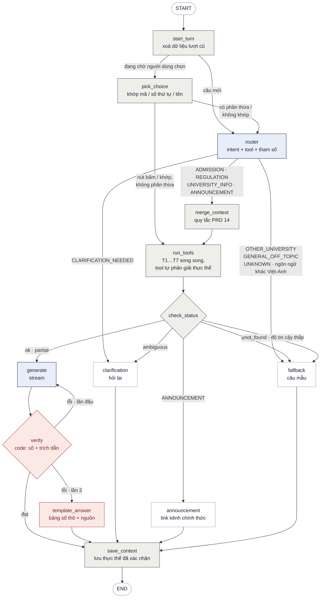

# Sơ đồ LangGraph — HUST Info & Admission Assistant

Bản sửa 2026-10-12, ghép bản thiết kế đầu với `docs/PLAN - Tuan 4 LangGraph (v1).md`. Mục 6 ghi những gì đã đổi so với bản đầu và vì sao.

## 1. Sơ đồ luồng



Chú thích màu: xanh là node có gọi LLM, xám là node tất định, đỏ là lớp kiểm soát an toàn, trắng là điểm vào/ra và các node trả câu mẫu.

**Số lần gọi LLM mỗi lượt:**

| Luồng | Số lần gọi |
|---|---|
| Từ chối, hỏi lại, thông báo | 1 (router) |
| Trả lời thường | 2 (router + generate) |
| Trả lời mà `verify` bắt lỗi | 3 |
| Người dùng chọn đúng một lựa chọn ở lượt trước | 1 (chỉ generate) |

LLM judge **không** nằm trong luồng; xem mục 7.

## 2. Bản ASCII

Dùng khi nơi hiển thị không render được Mermaid, ví dụ Word hoặc PDF xuất thẳng.

```text
START
  │
start_turn                                   xoá turn cũ; thêm tin nhắn vào lịch sử (giữ 3 lượt)
  ├─ context.pending ──► pick_choice         lượt trước đang hỏi lại
  │                        ├─ nút / khớp, không phần thừa ─► run_tools   chạy lại lệnh gọi cũ với mã đã chọn
  │                        └─ có phần thừa / không khớp ─┐               Router xử lý cả câu, kèm pending
  ▼                                                      │
router ◄─────────────────────────────────────────────────┘   1 lần LLM: intent + 0–3 lệnh gọi tool + tham số (gồm cả việc chặn injection)
  ├─ OTHER_UNIVERSITY / GENERAL_OFF_TOPIC / UNKNOWN / ngôn ngữ khác ──► fallback
  ├─ CLARIFICATION_NEEDED (cả câu thiếu thông tin) ───────────────► clarification
  ▼ ADMISSION / REGULATION / UNIVERSITY_INFO / ANNOUNCEMENT
merge_context                                C1–C5: điền phần thiếu từ ngữ cảnh cũ hoặc bỏ ngữ cảnh cũ
  │
run_tools                                    các tool chạy song song; Entity Resolution nằm TRONG tool
  │
check_status
  ├─ có tool `invalid` (quá 3 thực thể…) ──► fallback
  ├─ có tool `ambiguous` ─────────────────► clarification      lưu context.pending
  ├─ intent ANNOUNCEMENT ─────────────────► announcement       link official_channel_url (T6)
  ├─ mọi tool `not_found` / T7 độ tin cậy thấp ──► fallback     nói rõ thiếu gì, có sẵn gì
  ▼ ok / partial
generate ◄────────────┐                      stream; partial thì buộc nêu phần còn thiếu
  │                   │ lỗi lần đầu, kèm danh sách số/trích dẫn sai
verify ───────────────┘                      code: số lạ, dấu [n] trỏ nguồn không tồn tại
  ├─ lỗi lần 2 ──► template_answer           bảng số thô + nguồn, bỏ phần văn của LLM
  ▼ đạt
save_context  ◄── template_answer / clarification / announcement / fallback
  │                                          chỉ lưu mã ĐÃ xác nhận; từ chối thì giữ nguyên ngữ cảnh
END
```

## 3. Bảng node

| Node | Có LLM | Việc | Rẽ nhánh |
|---|---|---|---|
| `start_turn` | Không | Ghi đè `turn` bằng dict mới (xoá `answer`, `retry`, kết quả tool của lượt trước); thêm tin nhắn vào `messages`, cắt còn 3 lượt | `pending` có → `pick_choice`, không → `router` |
| `pick_choice` | Không | Trường `choice` của nút bấm, hoặc khớp chữ với `context.pending.candidates`: mã ("TE-E2"), khoá, số thứ tự ("cái thứ 2"), tên/đặc điểm ("hệ tiên tiến"). Chỉ đi đường tắt khi tin nhắn **không còn phần thừa**; có thêm thông tin ("TE-E2, năm 2024") thì Router xử lý cả câu và `merge_context` ghép với lệnh gọi đang chờ (chi tiết: `PLAN - State va Context Rules (v1).md` 4.3, 4.3b) | khớp, không phần thừa → `run_tools`; còn lại → `router` |
| `router` | Có | Một lần gọi structured output (2026-10-13: LLM trả `language`, `need`, `topic`; code ánh xạ `topic` → `intent` và thêm 4 luật chặn — `PLAN - Router (v1)` mục 11): `intent`, `calls` (0–3), `refers_to_context`, `language`, `scope_note`; khi đang chờ chọn thêm `pick_status` (`picked` / `new_question` / `cancel` / `unclear`) và `picked` (danh sách mã). Validate `args` bằng chính model `*Input` của tool; sai thì coi là `UNKNOWN` | theo intent |
| `merge_context` | Không | Quy tắc C1–C5 (plan mục 5): cùng tool thì điền ngành/năm/phương thức/khoá còn trống; khác tool thì chỉ mang ngành, Trường; không tham chiếu thì không mang gì. `pick_status = picked` thì ghép với lệnh gọi cũ trong `pending` (mã đã chọn bị khoá, luôn chạy câu hỏi gốc); `new_question`/`cancel` thì bỏ `pending`; `unclear` thì hỏi lại, lần 2 thả `pending` (`PLAN - State va Context Rules (v1).md` 4.3b, 4.3c) | → `run_tools` |
| `run_tools` | Không | `asyncio.gather` các hàm T1–T7. Tool tự phân giải thực thể (lọc năm B1, khớp chính xác B2, chuỗi con/fuzzy B3) và trả `ToolResult`. Lỗi DB/Qdrant bắt tại đây, ghi `error_code` | → `check_status` |
| `check_status` | Không | Đọc `status` của mọi `ToolResult` theo thứ tự ưu tiên: `invalid` → `ambiguous` → thông báo → toàn `not_found` → còn lại | xem sơ đồ |
| `generate` | Có | Viết câu trả lời **chỉ** từ JSON thu gọn của `ToolResult`; dấu `[n]` trỏ nguồn đã đánh số; không tự tính (chênh lệch lấy `deltas`, đổi tiền lấy `amount_vnd`) | → `verify` |
| `verify` | Không | Tách mọi con số trong câu trả lời, so với số có trong dữ liệu tool và câu hỏi; xoá/bắt lỗi `[n]` không tồn tại; học phí phải có đơn vị + năm | đạt → `save_context`; lỗi lần đầu → `generate`; lỗi lần 2 → `template_answer` |
| `template_answer` | Không | Dựng câu trả lời từ dữ liệu thô: bảng số + nguồn + phần `missing` | → `save_context` |
| `clarification` | Không | Câu hỏi lại + danh sách lựa chọn: **đủ** danh sách nếu alias đã khai báo `clarify`, cắt còn 3 nếu từ fuzzy. Hỏi khoá (T5/T7), hỏi ngành/năm khi cả câu thiếu. Ghi `context.pending` | → `save_context` |
| `announcement` | Không | Link `official_channel_url` của Trường/Khoa (T6) + lý do MVP không tra nội dung thông báo | → `save_context` |
| `fallback` | Không | Câu mẫu theo lý do (bản tiếng Việt và tiếng Anh, chọn theo `language`): trường khác, ngoài chủ đề, ngôn ngữ khác Việt–Anh (câu song ngữ), quá 3 thực thể, thiếu dữ liệu (nêu năm có sẵn), độ tin cậy thấp, lỗi DB/LLM | → `save_context` |
| `save_context` | Không | Cập nhật `context` từ `ToolResult.resolved` (chỉ mã đã xác nhận), `last_tool`, `last_intent`; xoá `pending` nếu lượt này không hỏi lại. Lượt từ chối thì **không** đổi ngữ cảnh | → END |

## 4. State

```python
from typing import TypedDict


class ConvContext(TypedDict, total=False):
    """Giữ qua các lượt (PRD 14). Chỉ chứa mã ĐÃ xác nhận."""
    programs: list[str]           # tối đa 3, như input của tool
    years: list[int]
    methods: list[str]
    cohort: str | None            # T5 chuẩn đầu ra, T7 quy định ngoại ngữ
    faculties: list[str]          # T6, T7
    last_tool: str | None         # quy tắc C2/C3 so theo tool
    last_intent: str | None
    pending: dict | None          # {"calls": [...], "mention": "kỹ thuật ô tô",
                                  #  "candidates": [{"code": "TE1", "name": ...}, ...]}


class Turn(TypedDict, total=False):
    """Chỉ sống trong một lượt; start_turn ghi đè bằng dict mới."""
    question: str
    router: dict                  # RouterOutput.model_dump()
    calls: list[dict]             # lệnh gọi tool sau merge_context
    results: list[dict]           # ToolResult.model_dump() theo thứ tự calls
    route: str                    # check_status chọn nhánh nào
    intent_final: str             # trả ra API metadata.intent (có thể là CLARIFICATION_NEEDED)
    fallback_reason: str | None
    answer: str
    citations: list[dict]         # dựng từ metadata, không từ LLM
    retry: int
    verify_issues: list[str]      # truyền ngược về generate khi viết lại
    trace_id: str | None          # khoá trỏ sang Langfuse


class ChatState(TypedDict):
    messages: list[dict]          # {role, content}, 3 lượt gần nhất
    context: ConvContext
    turn: Turn
```

## 5. Code dựng graph

```python
from langgraph.graph import StateGraph, START, END
from langgraph.checkpoint.postgres.aio import AsyncPostgresSaver

g = StateGraph(ChatState)
for name, fn in [
    ("start_turn", start_turn), ("pick_choice", pick_choice), ("router", router),
    ("merge_context", merge_context), ("run_tools", run_tools), ("check_status", check_status),
    ("generate", generate), ("verify", verify), ("template_answer", template_answer),
    ("clarification", clarification), ("announcement", announcement),
    ("fallback", fallback), ("save_context", save_context),
]:
    g.add_node(name, fn)

g.add_edge(START, "start_turn")
g.add_conditional_edges("start_turn",
    lambda s: "pick_choice" if s["context"].get("pending") else "router",
    ["pick_choice", "router"])
g.add_conditional_edges("pick_choice",
    lambda s: "run_tools" if s["turn"].get("calls") else "router",
    ["run_tools", "router"])


def after_router(s: ChatState) -> str:
    r = s["turn"]["router"]
    if s["context"].get("pending"):          # đang chờ chọn (PLAN - State va Context Rules 4.3c)
        if r.get("pick_status") == "unclear":
            return "clarification"           # hỏi lại; retries đến 2 thì thả pending + câu mẫu
        if r.get("pick_status") == "cancel":
            return "fallback"                # câu mẫu "Đã bỏ câu hỏi trước. Bạn muốn hỏi gì?"
        # picked → merge_context (bên dưới); new_question → xử lý như câu mới
    if r["language"] == "other" or r["intent"] in ("OTHER_UNIVERSITY", "GENERAL_OFF_TOPIC", "UNKNOWN"):
        return "fallback"
    if r["intent"] == "CLARIFICATION_NEEDED":
        return "clarification"
    return "merge_context"           # ADMISSION / REGULATION / UNIVERSITY_INFO / ANNOUNCEMENT


g.add_conditional_edges("router", after_router, ["fallback", "clarification", "merge_context"])
g.add_edge("merge_context", "run_tools")
g.add_edge("run_tools", "check_status")
g.add_conditional_edges("check_status", lambda s: s["turn"]["route"],
    ["fallback", "clarification", "announcement", "generate"])
g.add_edge("generate", "verify")


def after_verify(s: ChatState) -> str:
    t = s["turn"]
    if not t.get("verify_issues"):
        return "save_context"
    return "generate" if t.get("retry", 0) < 1 else "template_answer"


g.add_conditional_edges("verify", after_verify, ["save_context", "generate", "template_answer"])
for n in ("template_answer", "clarification", "announcement", "fallback"):
    g.add_edge(n, "save_context")
g.add_edge("save_context", END)

# Pool RIÊNG ghi được, search_path=langgraph — pool `hust` của tool là chỉ đọc
app = g.compile(checkpointer=AsyncPostgresSaver(write_pool))
```

Mọi cạnh có điều kiện đều liệt kê đủ đích, nên một giá trị lạ làm graph báo lỗi ngay khi chạy test, không rơi vào nhánh sai một cách im lặng.

## 6. Đổi gì so với bản đầu — và vì sao

| Bản đầu | Bản này | Vì sao |
|---|---|---|
| `input_guard` (LLM) + `router` (LLM) + `select_tools` (LLM) | Gộp thành **một** `router` | Ba lần gọi LLM nối tiếp trước khi có dữ liệu thì khó đạt P95 TTFT < 4 giây (PRD 22.1). Guard và router cùng phân loại "ngoài phạm vi", trong khi API phải trả `OTHER_UNIVERSITY` / `GENERAL_OFF_TOPIC` tách riêng (PRD 19); hai chỗ cùng quyết thì AC3 đo không rõ. Prompt injection là một dạng `GENERAL_OFF_TOPIC` |
| Node `entity_resolution` riêng, một giá trị `resolution` cho cả lượt | Bỏ; tool tự phân giải, `check_status` rẽ nhánh theo `status` của từng `ToolResult` | Code Tuần 3 đã phân giải **bên trong** tool, mỗi tool một ngữ cảnh: lọc năm B1 ("kế toán" → EM-E17 hay EM4), T4 chỉ dùng năm trong `program_years`, T6 phân giải Trường/Khoa, T5 cần khoá. Node chung phải làm lại tất cả, dễ lệch 104 ca AC2/AC8 đã duyệt. Một lượt có 2–3 tool thì cần kết quả phân giải theo từng tool. Tool vẫn dừng ở `ambiguous` **trước** khi truy vấn, nên AC8 giữ nguyên |
| Không có nhánh cho câu không nhắc ngành | Không cần: tool không có thực thể thì chạy bình thường | Phần lớn câu RAG (cảnh báo học tập, Q10, Q18) không nhắc ngành; bản đầu sẽ đẩy chúng sang `not_found` hoặc báo lỗi thiếu cạnh |
| Router thiếu cạnh cho `CLARIFICATION_NEEDED`, `UNKNOWN` | Có đủ cạnh, cả ngôn ngữ khác Việt–Anh | Thiếu cạnh thì LangGraph báo lỗi khi gặp giá trị đó |
| State phẳng; checkpointer lưu cả `retry_count`, `answer` sang lượt sau | Tách `turn` (xoá mỗi lượt) và `context` (giữ qua lượt); thêm `start_turn` | Bản đầu: lượt trước thử lại 2 lần thì lượt sau trượt `verify` lần đầu là vào thẳng `review_queue` |
| Không ai đọc `candidates`; không áp quy tắc reset | `pick_choice` + `merge_context` + `save_context` | Người dùng trả lời "TE-E2" phải được hiểu là chọn lựa (PRD 14, dòng 3); "Thế còn 2025?" phải mang IT1 sang (US3) |
| `current_program` một giá trị | `programs: list[str]` (tối đa 3), thêm `cohort`, `faculties` | Tool nhận tới 3 ngành/năm (PRD 10.2); T5/T7 cần khoá, T6 cần Trường |
| `verify` gồm code + LLM judge, chạy trong luồng | `verify` chỉ có code; judge ra ngoài luồng (mục 7) | Judge trong luồng nghĩa là phải chờ sinh xong cả câu rồi chấm, mới gửi chữ đầu tiên, tức không stream được. gpt-4o-mini tự chấm chính nó cũng yếu |
| Trượt `verify` 2 lần → `review_queue` → `fallback` | Trượt lần 2 → `template_answer` | Dữ liệu vẫn có, chỉ LLM diễn đạt sai; trả "không tìm thấy" là bỏ phí câu trả lời đúng. Viết lại 1 lần (thay vì 2) cho nhẹ độ trễ |
| `review_queue` ghi DB cho trang admin | Bỏ khỏi luồng; tạm gắn tag trên Langfuse | Pool `hust` chỉ đọc; trang admin không có trong PRD. Muốn có thì là câu hỏi Q11 của plan |
| `output_guard` riêng | Gộp vào `verify` | Kiểm trích dẫn bắt buộc và định dạng đều là code, chạy chung một chỗ. Không có dữ liệu cá nhân để lộ (PRD 4.1, 23) |
| `clarification` tối đa 3 lựa chọn | Đủ danh sách nếu alias khai báo `clarify`; cắt 3 nếu từ fuzzy | Đúng điều anh đã chốt 2026-10-07 |
| `announcement` đi thẳng từ router | Đi qua `merge_context` + `run_tools` (T6) | Phải phân giải Trường/Khoa ("Trường Điện", "Viện CNTT") và hỏi lại khi mơ hồ; M8 cần mang Trường từ lượt trước |
| `PostgresSaver` | `AsyncPostgresSaver`, pool riêng ghi được | Dự án dùng psycopg async; schema `langgraph` tách khỏi `hust` để `build_db.py` dựng lại dữ liệu không mất hội thoại |

**Giữ nguyên từ bản đầu:** `check_coverage` (nay là `check_status`) nằm **sau** tool; vòng viết lại có trần và truyền lý do ngược về; mọi nhánh kết thúc bằng một node trả nội dung; tách màu theo loại node.

## 7. Ghi chú khi cài đặt

- **Stream mà `verify` bắt lỗi:** chữ đã gửi rồi thì không rút lại được. API gửi thêm sự kiện SSE `replace` kèm câu trả lời mới; giao diện Tuần 5 thay toàn bộ nội dung. `/api/chat` (không stream) chỉ trả bản cuối.
- **LLM judge:** chạy nền sau khi đã trả lời (ghi điểm vào Langfuse), hoặc chỉ dùng lúc đo Tuần 6. Chờ anh chọn (plan Q11).
- **Lỗi bên ngoài** (Postgres, Qdrant, OpenAI): bắt trong node, ghi `fallback_reason` theo mã lỗi PRD 24 rồi đi `fallback`. Router gọi LLM lỗi thì thử lại 1 lần trước.
- **Thông báo mà không rõ Trường/Khoa nào** (và ngữ cảnh cũng không có): router trả `CLARIFICATION_NEEDED` với `missing_info = "Trường/Khoa"`.
- **Langfuse:** nếu gọi thẳng SDK `openai` (plan Q2) thì callback cấp graph không bắt được lượt gọi LLM; dùng wrapper `langfuse.openai` + `@observe` cho từng node. Lấy `trace_id` trả ra API `metadata`.
- **Test không mạng:** thay `router` và `generate` bằng hàm giả trả kết quả định sẵn, dùng `InMemorySaver`. Test từng nhánh của sơ đồ và từng quy tắc C1–C5.
